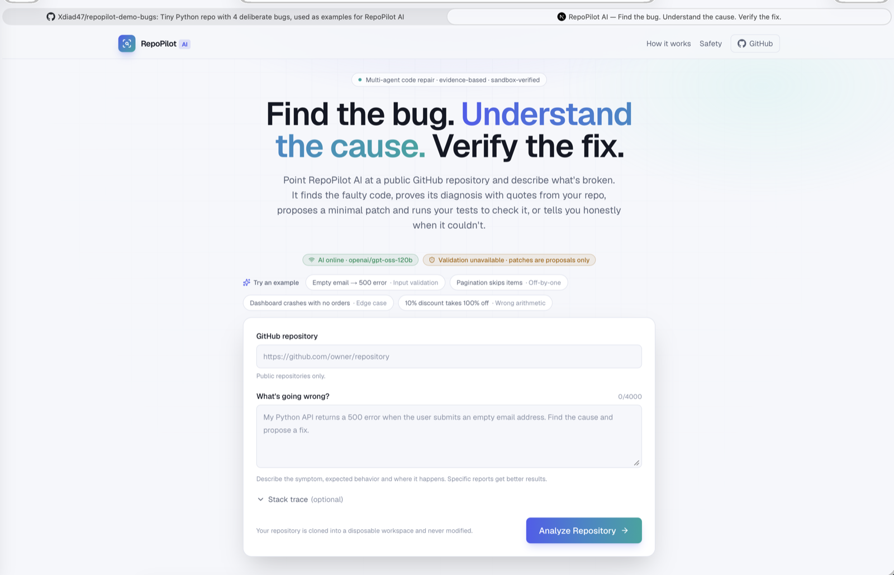
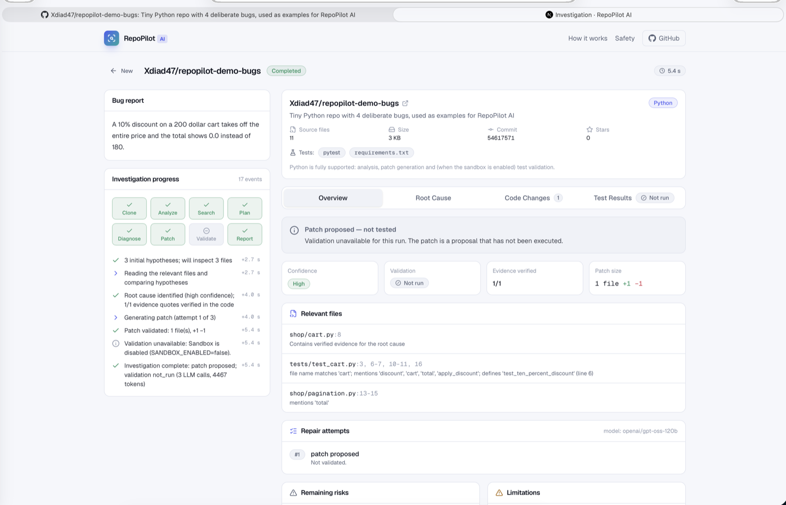
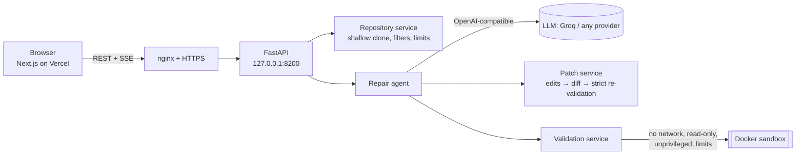

# RepoPilot AI

**Find the bug. Understand the cause. Fix it with evidence.**

RepoPilot AI is a multi-agent code-repair system. Give it a public GitHub repository and a bug report; it inspects the
real source, proves its diagnosis with code quoted from the repo, proposes a minimal patch, and (when a sandbox is
available) runs the project's tests before and after the patch. It never claims a fix it didn't verify.

**Live:** https://repo-pilot-ai-three.vercel.app · **API health:** https://repopilot-api.scanlyy.in/api/health





> The public demo runs with test validation **off** (the server is shared), so patches there are shown as
> *proposals — not tested*. With a sandbox enabled, the same pipeline runs the tests before and after the patch.

> **The core idea is honest, evidence-based repair.** Every cited line is checked against the actual file, every patch
> is re-validated before it is shown, and validation is one of `passed`, `failed`, `inconclusive` or `not_run`, taken
> from real exit codes.

---

## How it works



| Stage | What really happens |
| --- | --- |
| **Clone** | GitHub metadata check, hardened shallow clone into a private per-investigation workspace (no hooks, no submodules, no symlinks). |
| **Analyze** | Language, manifests, test framework, stack-trace frame → file mapping, keyword search, symbol ranking (Python via `ast`). |
| **Plan** | LLM proposes hypotheses and files to read. Only paths that exist are accepted. |
| **Diagnose** | LLM compares hypotheses and must quote real code. Quotes are located in the file; unverifiable evidence lowers confidence or stops the run. |
| **Patch** | LLM returns exact `search → replace` edits (not a hand-written diff). The backend builds the unified diff itself, then dry-run applies it with zero fuzz. Protected files (secrets, CI, lockfiles, test config, existing tests) are rejected. |
| **Validate** | Baseline run, patch applied to a disposable copy, patched run, compared. Failures feed back into a bounded retry loop. |

### Validation statuses

| Status | Meaning |
| --- | --- |
| `passed` | The patched run exited 0 (`scope: full_suite`), **or** previously failing tests now pass with no new failures (`scope: targeted`; unrelated pre-existing failures are reported). |
| `failed` | Tests still fail, or the patch introduced new failures. |
| `inconclusive` | Timeout, collection/import errors, missing dependencies in the offline sandbox, sandbox crash. |
| `not_run` | "Validation unavailable": sandbox disabled/unreachable, non-Python repo, or no tests. |

## Repository layout

```
backend/            FastAPI app (Python 3.11+)
  app/api/          routes + dependency wiring
  app/core/         config, security helpers, rate limiting, logging
  app/schemas/      API models and the LLM response contracts
  app/services/     repository, analyzer, llm, repair_agent, patch, validation, investigation (lifecycle/SSE)
  app/prompts/      prompt templates (untrusted-data fencing lives here)
  tests/            321 tests
frontend/           Next.js 16 · TypeScript · Tailwind v4 (deployed to Vercel)
deploy/             nginx template, systemd unit, env templates, sandbox Dockerfile, VPS scripts
demo_repos/         repopilot-demo-bugs: a tiny repo with 4 deliberate bugs for one-click demos
docs/               DEPLOYMENT.md, SECURITY.md
```

## Local setup

Requirements: Python 3.11+, Node 20.9+ (22 recommended), Git. Docker is optional (only for test validation).

### 1. Backend

```bash
cd backend
python3 -m venv .venv && source .venv/bin/activate
pip install -r requirements-dev.txt
cp .env.example .env          # then set LLM_API_KEY (never commit this file)
uvicorn app.main:app --reload --port 8000
```

Check it: `curl localhost:8000/api/health` (shows configuration status, never secrets). Interactive API docs are at
`/docs` in development.

**LLM provider.** Any OpenAI-compatible endpoint works by changing three variables:

| Provider | `LLM_BASE_URL` | `LLM_MODEL` (example) |
| --- | --- | --- |
| Groq (default) | `https://api.groq.com/openai/v1` | `openai/gpt-oss-120b` |
| OpenAI | `https://api.openai.com/v1` | `gpt-4o-mini` |
| Self-hosted vLLM (e.g. on AMD ROCm) | `http://localhost:8000/v1` | your served model |

Groq's free tier is limited to ~8,000 tokens/minute. RepoPilot respects `Retry-After`/`x-ratelimit-reset-tokens`, caps
output tokens per step, and keeps prompts small; expect a pause on large investigations.

### 2. Frontend

```bash
cd frontend
cp .env.example .env.local     # NEXT_PUBLIC_API_BASE_URL=http://localhost:8000
npm install
npm run dev                    # http://localhost:3000
```

### 3. Optional: enable sandboxed test validation locally

```bash
docker build -t repopilot-sandbox:latest deploy/sandbox
# in backend/.env:
SANDBOX_ENABLED=true
```

`/api/health` then reports `sandbox.available: true` and the UI shows "Sandboxed test validation on".

## Tests, lint and build

```bash
# backend
cd backend && ruff check . && pytest

# frontend
cd frontend && npm run lint && npm run typecheck && npm test && npm run build
# or everything: npm run check
```

CI (`.github/workflows/ci.yml`) runs the same commands on every push.

## API

| Endpoint | Description |
| --- | --- |
| `GET /api/health` | Service + configuration status (no secrets). |
| `POST /api/repair` | Start an investigation → `202 {repair_id, status_url, events_url}`. |
| `GET /api/repair/{id}` | Full investigation: status, repository info, events, result. |
| `GET /api/repair/{id}/diff` | The patch as a downloadable `.patch` (404 when none exists). |
| `GET /api/repair/{id}/events` | Server-sent events: real progress, replayable with `Last-Event-ID`. |

Errors always look like `{"error": {"code": "...", "message": "...", "fields": {...}}}`.

## Deployment

The full, step-by-step guide is in **[docs/DEPLOYMENT.md](docs/DEPLOYMENT.md)**. In short:

1. **Backend → VPS** behind nginx on its own subdomain (`deploy/scripts/install-backend.sh`, then `install-nginx.sh`, then `certbot`).
2. **DNS**: one `A` record for the API subdomain → the VPS IPv4.
3. **Frontend → Vercel**: import the repo, set *Root Directory* = `frontend`, set `NEXT_PUBLIC_API_BASE_URL=https://<api-subdomain>`.
4. Set `FRONTEND_ORIGIN` on the VPS to the Vercel URL (CORS), restart, run the smoke-test checklist.

### What is prepared vs. what needs your action

| Done in this repository | Needs you |
| --- | --- |
| Backend, frontend, tests, CI | Choose the API subdomain and add the DNS `A` record |
| systemd unit, nginx template, env templates, install/rollback scripts | Review and run the scripts on the VPS (approval gate) |
| Sandbox image definition | Put the real `LLM_API_KEY` into `/etc/repopilot/backend.env` on the server |
| Vercel-ready build and env docs | Create the Vercel project and set `NEXT_PUBLIC_API_BASE_URL` |

## Security model and limitations

See **[docs/SECURITY.md](docs/SECURITY.md)**. Highlights:

* Repository content is untrusted: shallow clone with hooks/symlinks/submodules disabled, size/file/time limits, never executed in the API process.
* The LLM has no tools. It returns JSON that is schema-validated; it never chooses commands. Prompts fence untrusted text and neutralise forged tags.
* Tests run only inside a Docker sandbox: no network, read-only root FS, all capabilities dropped, uid 65534, CPU/memory/PID/output/time limits. If it isn't available, validation is reported as unavailable, never faked.
* The sandbox is offline, so project dependencies are not installed: repositories that need third-party packages to run their tests will report `inconclusive`.
* AI-generated patches can be wrong. Always review them.

## Troubleshooting

| Symptom | Cause / fix |
| --- | --- |
| UI says "Backend offline" | Backend not running, wrong `NEXT_PUBLIC_API_BASE_URL`, or CORS: `FRONTEND_ORIGIN` must contain the exact frontend origin. |
| UI says "Missing configuration" | Production build without `NEXT_PUBLIC_API_BASE_URL` (it's required; no fallback). Set it in Vercel and redeploy. |
| "AI provider not configured" | `LLM_API_KEY`/`LLM_BASE_URL`/`LLM_MODEL` empty. See `/api/health`. |
| "The AI provider is rate limiting…" | Provider token-per-minute limit. Retry shortly or use a higher tier. The analysis is kept even if patching fails. |
| Validation "unavailable" | `SANDBOX_ENABLED=false`, Docker unreachable, or image missing (`docker build -t repopilot-sandbox:latest deploy/sandbox`). |
| Validation "inconclusive: import errors" | The repo needs third-party packages; the offline sandbox only has pytest + stdlib. |
| Live progress doesn't stream in production | nginx must not buffer SSE; use `deploy/nginx/repopilot-api.conf.template` (the UI falls back to polling automatically). |
| `429 rate_limited` | Per-visitor hourly limit (`RATE_LIMIT_PER_HOUR`) or the global daily cap (`DAILY_GLOBAL_LIMIT`). |

## Maintenance and rollback

* Logs: `journalctl -u repopilot-api -f` · Status: `systemctl status repopilot-api` · Health: `deploy/scripts/healthcheck.sh`
* Update: re-run `deploy/scripts/install-backend.sh` (it records the previous revision).
* Rollback: `deploy/scripts/rollback.sh`. Frontend rollback: promote a previous deployment in the Vercel dashboard.
* **Groq API key expires 2027-01-21** (itzeazy account). Regenerate it before then and update `/etc/repopilot/backend.env`.

## License

MIT (add a `LICENSE` file before publishing if you want this to be formally open source).
